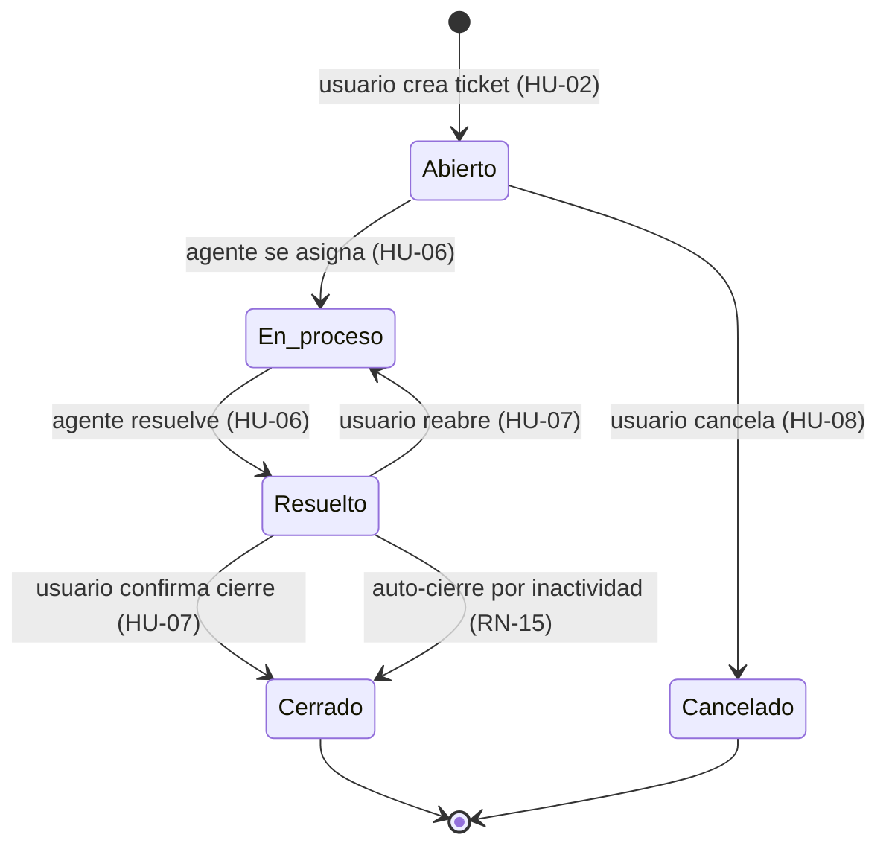
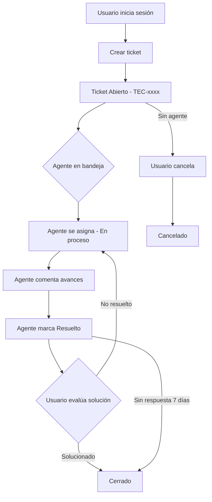
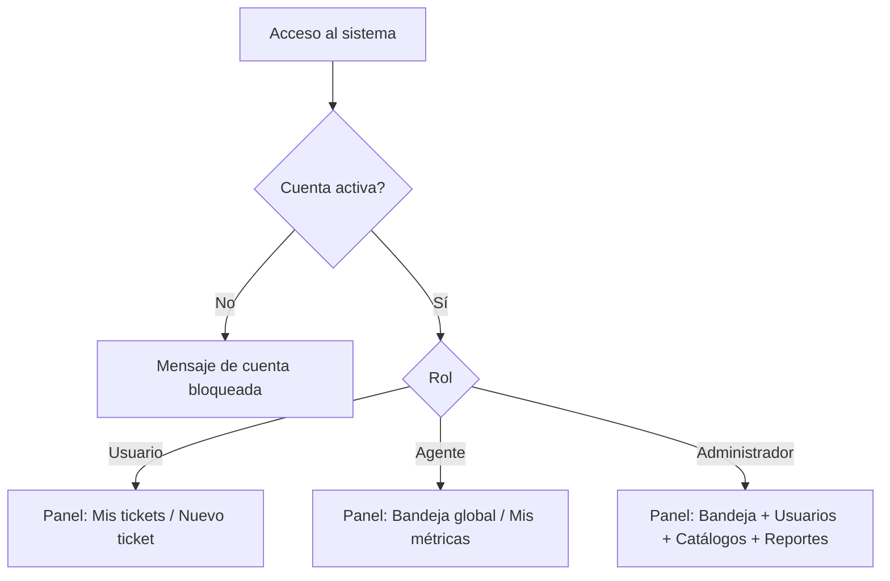
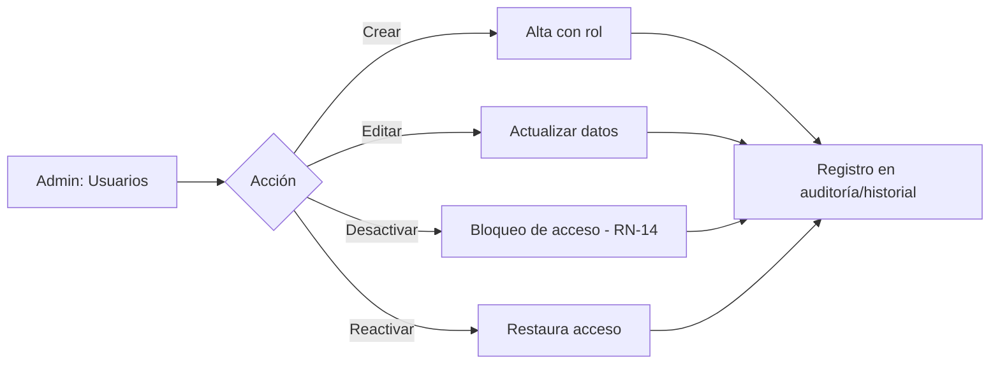

# Tec-flow — Modelado de Procesos

## 1. Ciclo de vida del ticket (estados)

## 2. Flujo principal: creación y atención de un ticket

## 3. Flujo de autenticación y autorización

## 4. Proceso administrativo de usuarios

## Notas de modelado

- Los diagramas usan notación Mermaid y se visualizan en GitHub.
- Las transiciones respetan las reglas RN-05 a RN-09 de `06-reglas-de-negocio.md`.
- El estado **Resuelto → Cerrado** por inactividad (RN-15) puede implementarse como tarea programada o al consultar el ticket; la decisión se toma en la fase de diseño.
