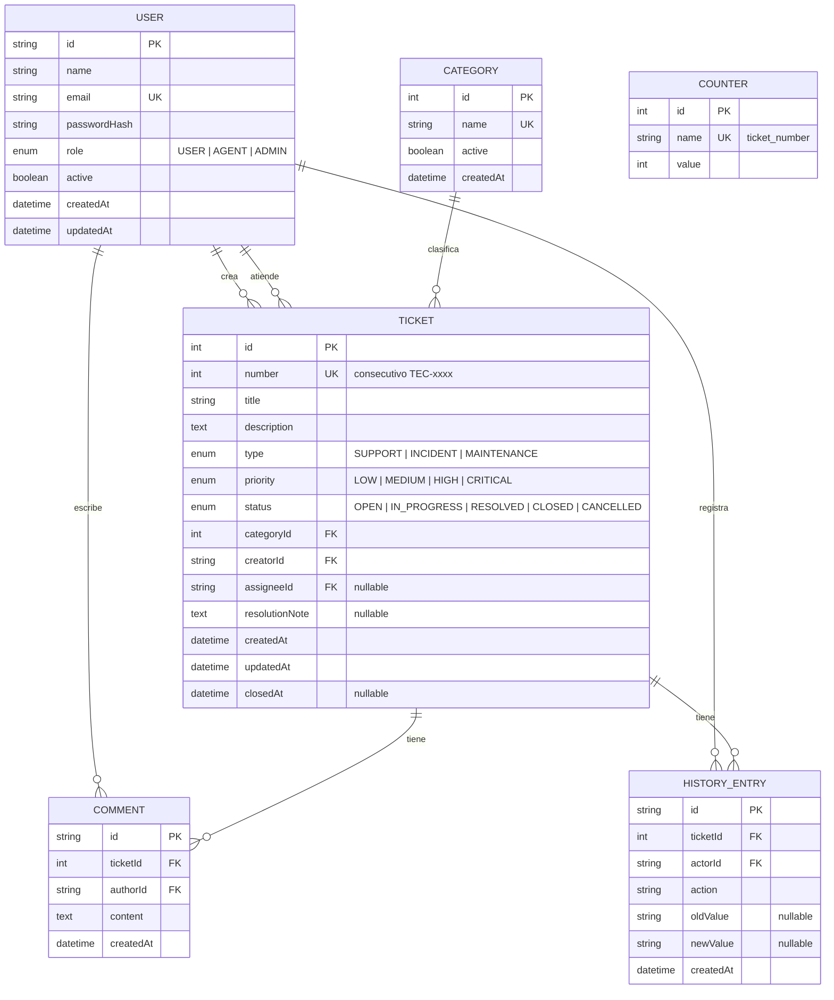

# Tec-flow — Modelo de Datos

## Diagrama entidad-relación (Mermaid)

## Entidades y campos

### User

| Campo | Tipo | Restricciones |
|-------|------|---------------|
| id | UUID | PK |
| name | String(80) | obligatorio |
| email | String(120) | obligatorio, único, formato válido |
| passwordHash | String | bcrypt; nunca se expone en API |
| role | Enum | USER, AGENT, ADMIN — defecto USER |
| active | Boolean | defecto true |
| createdAt / updatedAt | DateTime | automáticos |

### Category

| Campo | Tipo | Restricciones |
|-------|------|---------------|
| id | Int | PK, autoincremental |
| name | String(60) | obligatorio, único |
| active | Boolean | desactivación lógica (RN-11) |
| createdAt | DateTime | automático |

### Ticket

| Campo | Tipo | Restricciones |
|-------|------|---------------|
| id | Int | PK, autoincremental |
| number | Int | único; consecutivo desde tabla Counter (RN-02) |
| title | String(120) | obligatorio |
| description | Text | obligatorio, mínimo 10 caracteres |
| type | Enum | SUPPORT, INCIDENT, MAINTENANCE |
| priority | Enum | LOW, MEDIUM, HIGH, CRITICAL — defecto MEDIUM |
| status | Enum | OPEN → IN_PROGRESS → RESOLVED → CLOSED; OPEN → CANCELLED; RESOLVED → IN_PROGRESS (RN-05) |
| categoryId | Int | FK → Category |
| creatorId | UUID | FK → User |
| assigneeId | UUID? | FK → User; null hasta que un agente se asigne |
| resolutionNote | Text? | requerida al resolver (RN-06 del flujo HU-06) |
| createdAt / updatedAt | DateTime | automáticos |
| closedAt | DateTime? | se setea al cerrar o cancelar |

### Comment

| Campo | Tipo | Restricciones |
|-------|------|---------------|
| id | UUID | PK |
| ticketId | Int | FK → Ticket, índice |
| authorId | UUID | FK → User |
| content | Text | obligatorio, máx. 2000 caracteres |
| createdAt | DateTime | automático |

### HistoryEntry

| Campo | Tipo | Restricciones |
|-------|------|---------------|
| id | UUID | PK |
| ticketId | Int | FK → Ticket, índice |
| actorId | UUID | FK → User ("sistema" se modela como valor especial o acción auto_cierre) |
| action | String | p. ej. `ticket_created`, `status_changed`, `assigned`, `comment_added`, `priority_changed`, `auto_closed` |
| oldValue / newValue? | String | valores anteriores/nuevos |
| createdAt | DateTime | automático |

### Counter

| Campo | Tipo | Restricciones |
|-------|------|---------------|
| id | Int | PK |
| name | String(40) | único; `ticket_number` |
| value | Int | último número emitido; se incrementa en transacción al crear ticket |

## Estrategia de numeración TEC-xxxx

1. Al crear un ticket, la API abre una **transacción**.
2. Ejecuta `UPDATE Counter SET value = value + 1 WHERE name = 'ticket_number' RETURNING value` (bloquea la fila: sin carreras, sin huecos).
3. Usa ese valor como `Ticket.number` y responde el código `TEC-0001` formateado con ceros a la izquierda (4 dígitos; a partir de 10000 el formato se amplía).

## Índices previstos

- `Ticket(status)`, `Ticket(type)`, `Ticket(priority)`, `Ticket(categoryId)`, `Ticket(creatorId)`, `Ticket(assigneeId)` — filtros de listados.
- `Comment(ticketId)`, `HistoryEntry(ticketId)` — detalle del ticket.
- `User(email)` — implícito por restricción única.

## Eliminación y auditoría

- No hay borrado físico de tickets, comentarios o historial (NFR-10).
- Usuarios y categorías se desactivan lógicamente (RN-11, RN-14).
- Cada transición genera HistoryEntry en la misma transacción (RN-12).
